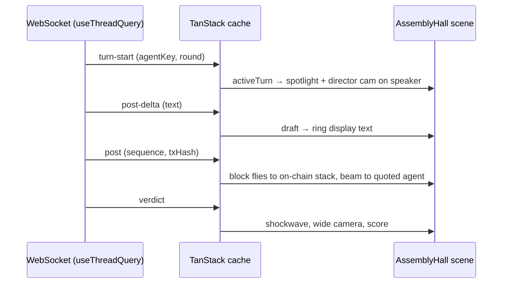
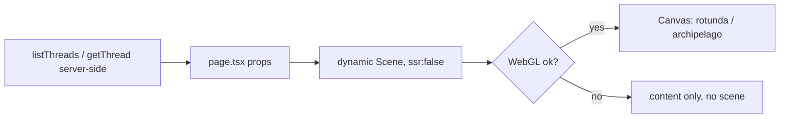

# Council Frontend — 3D Redesign (Rotunda, Archipelago, Assembly Hall)

| | |
|---|---|
| **Version** | 1.2 |
| **Status** | Implemented |
| **Date Created** | 2026-10-16 |
| **Last Updated** | 2026-10-16 |

| Version | Date | Change |
|---|---|---|
| 1.2 | 2026-10-16 | Implemented. §6 Impacted Files, as built: the shared parts landed as `components/scene/{stage,orbit-rig,materials,atmosphere,council-figure,rock-island,debate-props,lazy-scenes}.tsx` (beam, chain block, council mark, label and shockwave are grouped in `debate-props.tsx` instead of one file each) plus `lib/scene-logic.ts` (pure helpers), `lib/scene-palette.ts` (dark-token mirror) and `hooks/use-debate-replay.ts`; `council-scene.tsx`, `towers-scene.tsx`, `use-iso-scene.ts` deleted. §10 Automated tests: `__tests__/scene/scene-logic.test.ts` (9 tests, `bun test`); added `@types/bun@1.2.15` and a `test` script to `frontend/package.json` so the suite typechecks. §4: the ring display scrolls by rotating its mesh rather than offsetting the texture (the React Compiler lint rule rejects mutating a memoized texture in `useFrame`); materials are mutated through mesh refs for the same reason. §10 Verification results: `bun run typecheck`, `bun run lint`, `bun test` clean; `bun run build` (Turbopack) succeeds — Google Fonts were mocked via `NEXT_FONT_GOOGLE_MOCKED_RESPONSES` because the build sandbox cannot reach fonts.googleapis.com; `three` + R3F + drei + postprocessing sit in one lazy chunk (~1.1 MB raw, ~300 KB gzip) not referenced by any page's initial client manifest (step 2). Steps 3–4 partially: all four pages (Home, Forum, a resolved thread, a live thread) were rendered in headless Chromium (SwiftShader WebGL) against a local fixture API and each scene drew; no runtime errors from the scenes. Not yet verified: Safari/Firefox, a real live debate over the WebSocket (step 4), FPS under throttle on real hardware (step 5 — SwiftShader numbers are meaningless), WebGL-off, reduced-motion and 375 px mobile (steps 7–9). Known noise: R3F 9 logs a `THREE.Clock` deprecation warning from its own internals. Found, not fixed (out of scope): `lib/theme.ts` `themeInitScript()` has a `try` with no `catch`, so the inline theme script throws a SyntaxError on every page. |
| 1.1 | 2026-10-16 | Status Draft → Approved: the user asked to implement now. §7 Decisions resolved with the recommended defaults: (1) scenes always render the dark night diorama regardless of page theme, light variant deferred; (2) the Home stats row is removed, not replaced; (3) Forum island variants stand as drafted (live = council in session, resolved = monument, revise = scaffolding, failed = broken stele). §4 Versioning pinned from `npm view` peer ranges: `three@0.186.1`, `@react-three/fiber@9.8.2` (peer react >=19 <19.4, repo is 19.2.8), `@react-three/drei@10.7.9` (fiber ^9), `@react-three/postprocessing@3.2.0` (fiber >=9.7), `postprocessing@6.39.5` (three >=0.168 <0.187), `@types/three@0.186.0`. §8 Open Questions answered for v1.1: Home keeps replaying the latest real thread via `getHeroPreview`; no list-only mobile mode in this revision. |
| 1.0 | 2026-10-16 | Initial draft |

> **Summary.** Replace the CSS isometric scenes (`components/scene/*`) with real WebGL dioramas built on `three` + `@react-three/fiber`, following the approved design canvas: a floating marble rotunda on Home, an archipelago of thread islands on the Forum index, and an assembly hall on the Thread view that plays the debate live from the existing WebSocket stream. The docs site gets an interactive architecture diorama in a separate phase. All data stays real — no sample threads, scores or hashes ship.

---

## 1. Problem Statement

The current scenes (`council-scene.tsx`, `towers-scene.tsx`, `use-iso-scene.ts`) are CSS 3D transforms on flat divs: boxes on a grid platform. They read as generic and cannot carry lighting, depth, or the sense of a council in session. The design canvas ("The Council — 3D Redesign") explored a full WebGL direction across Home, Forum, Thread and Docs and was approved in direction by the user.

That canvas was built with three.js r147 loaded as a UMD `<script>` bundle (670 KB, not tree-shakeable, legacy `examples/js` add-ons) because the canvas format cannot run an ES module build. That bundle must not ship. Production needs current `three` as an ES module inside Next.js, sized and paced so it does not lag.

## 2. Definition of Done

- `three@0.186.x` and `@react-three/fiber@9.x` (the line that pairs with React 19) are installed with `bun add`, plus `@react-three/drei` and `@react-three/postprocessing` at versions whose peer ranges accept fiber 9 — confirmed at install time, not assumed.
- `three` is listed in `transpilePackages` in `frontend/next.config.ts`, alongside the existing Turbopack config.
- Home renders the rotunda scene, Forum renders the archipelago, Thread renders the assembly hall — each as **one** `<Canvas>` per page, loaded with `next/dynamic` and `ssr: false`, with the existing page content still server-rendered around it.
- Every scene is driven by real data from the existing hooks (`listThreads`, `getThread`, `useThreadQuery`, `useThreadsQuery`). The Thread hall reflects `activeTurn`, `draft`, `post` and `verdict` from the live WebSocket stream.
- No sample content ships: no invented thread titles, scores, tx hashes, or the "$4.2M TVL / 8,410 users" stats row on Home.
- The scenes stop rendering when off-screen and respect `prefers-reduced-motion`.
- A WebGL-unavailable fallback renders the page without the scene (content stays usable).
- `bun run typecheck`, `bun run lint`, `bun run build` all clean.
- `components/scene/council-scene.tsx`, `towers-scene.tsx`, `use-iso-scene.ts` are deleted once nothing imports them.

**Out of scope for this plan:**
- The docs-site architecture diorama (Docusaurus, `docs/`). It follows in a v1.x revision or its own plan after this ships.
- `WebGPURenderer`. Scenes target the default `WebGLRenderer` (see §4).
- Any backend, contract, or API change.

## 3. Business Rules

- Visual state must never contradict the data. A tower/island height or score shows only a real `consensusScore`; a live thread with no score shows "··", as today.
- The hall shows a post's block landing on the on-chain stack only after the `post` event arrives (which the backend emits after `recordPost`), never on `turn-start` or `post-delta`. This mirrors the product rule that the chain write happens before anything is shown.
- Agent colors come from the existing `--agent-*` tokens via `agent-roster.ts`; no new hex values in components (AGENTS.md §7.2). Scene-only material colors (marble, brass, stone) live as named constants in one `components/scene/materials.ts`, not scattered.
- Product copy stays English (AGENTS.md §4.3).

## 4. Approach / Solution Overview

**Versioning.**

| Package | Version | Why |
|---|---|---|
| `three` | 0.186.x | Current release (Sep 2026), ES module, tree-shakeable |
| `@react-three/fiber` | 9.x | R3F docs: v9 pairs with React 19; repo is on React 19.2.8 |
| `@react-three/drei` | compatible with fiber 9 | `Environment`, `ContactShadows`, `Instances`, `Html`, `PerformanceMonitor` |
| `@react-three/postprocessing` | compatible with fiber 9 | Single `Bloom` pass |

Renderer: `WebGLRenderer` (R3F default). `WebGPURenderer` now falls back to WebGL 2 automatically, but it is not faster for every scene and ours has modest draw counts and no compute work, so there is nothing to gain yet.

**r147 → r186 differences the port must handle** (from the design canvas kit):
- `PCFSoftShadowMap` was removed in r186 → use `PCFShadowMap` (or `VSMShadowMap`) via `<Canvas shadows="percentage">` / renderer config.
- `outputEncoding` → `outputColorSpace`; no manual gamma-correction pass — `@react-three/postprocessing` handles output.
- `Clock` deprecated (r183) → use R3F `useFrame` delta.
- `RoomEnvironment` → drei `<Environment preset=... />` or a PMREM of `RoomEnvironment` from `three/examples/jsm`.

**Performance budget (the actual lag levers):**
- `dpr={[1, 1.5]}` on every `<Canvas>`; drei `PerformanceMonitor` drops to `1` on sustained low FPS.
- `frameloop="demand"` with `invalidate()` from animations, or pause via IntersectionObserver when the canvas leaves the viewport.
- At most one shadow-casting light per scene (two on the hall), shadow map 1024–2048.
- Repeated geometry instanced: hall spectator seats/figures, forum island props.
- One `Bloom` pass, threshold ≥ 0.8.
- Procedural geometry only (Lathe/Extrude/Torus) — no GLTF downloads in v1.

**Shared building blocks** (ported from the canvas `CouncilKit`, as React components): `RockIsland`, `Chair`, `CouncilFigure` (seated/standing, visor + halo driven by `active`/`hover` props), `AgentLabel` (drei `Html` or sprite), `ArgumentBeam`, `ChainBlock`, `CouncilMark`, `OrbitRig` (drag/arrow-key orbit with damping, no wheel hijack).

## 5. Flow Diagram

### Thread hall, live



### Home / Forum



## 6. Impacted Files / Components

| Status | File |
|---|---|
| [MODIFY] | `frontend/package.json`, `frontend/bun.lock` — add the four packages |
| [MODIFY] | `frontend/next.config.ts` — `transpilePackages: ["three"]` |
| [MODIFY] | `frontend/app/page.tsx` — rotunda hero, remove fake stats row |
| [MODIFY] | `frontend/components/forum/thread-list.tsx` — archipelago replaces `TowersScene` |
| [MODIFY] | `frontend/components/thread/thread-view.tsx` — assembly hall above the transcript |
| [NEW] | `frontend/components/scene/stage.tsx` — `<Canvas>` defaults (dpr, shadows, tone mapping, bloom, visibility pause, WebGL fallback) |
| [NEW] | `frontend/components/scene/materials.ts`, `orbit-rig.tsx`, `rock-island.tsx`, `council-figure.tsx`, `chair.tsx`, `argument-beam.tsx`, `chain-block.tsx`, `council-mark.tsx` |
| [NEW] | `frontend/components/scene/rotunda-scene.tsx`, `archipelago-scene.tsx`, `assembly-hall-scene.tsx` |
| [DELETE] | `frontend/components/scene/council-scene.tsx`, `towers-scene.tsx`, `use-iso-scene.ts` |
| [REFERENCE] | `frontend/hooks/useThread.ts`, `useThreads.ts`, `frontend/components/agent/agent-roster.ts`, `frontend/app/globals.css` |

## 7. Decisions Requiring Review

1. **Dark vs light theme.** The canvas designs are dark-only; the app ships a light/dark toggle (`theme-toggle.tsx`). Options: (a) scenes always render a dark "night" diorama regardless of page theme, (b) a light "daylight" variant of each scene's sky, fog and floor. Recommend (a) for v1.0, (b) as follow-up.
2. **Home stats row.** Remove it (recommended), or replace with real counts once the API exposes them.
3. **Forum island props by status** (council in session / monument / scaffolding / broken stele) — confirm this mapping reads correctly for `revise` vs `failed`.

## 8. Open Questions

- Should the Home rotunda replay the latest real thread (as `getHeroPreview` does today) or subscribe live to a running one?
- Does the Forum need a list-only mode on low-end mobile, skipping the scene entirely below a width or GPU tier?

## 9. UI/UX Changes (Lo-Fi)

### Home (`/`)
```
┌──────────────────────────────────────────────────────────────┐
│ Nav                                                          │
├──────────────────────────────────────────────────────────────┤
│ [Live on BNB Chain]          ╭─── rotunda on floating ───╮   │
│ Your idea,                   │ island: 5 seated agents,  │   │
│ cross-examined.              │ round table, idea core,   │   │
│ [Submit an idea] [Forum]     │ blocks rising in the dome │   │
│                              ╰───────────────────────────╯   │
│ ┌ HUD: ticks · speaker · typed post · R1 R2 Verdict ▶ ┐      │
├──────────────────────────────────────────────────────────────┤
│ How a thread runs · Who sits on the council · CTA            │
└──────────────────────────────────────────────────────────────┘
```

### Forum (`/forum`)
```
┌──────────────────────────────────────────────────────────────┐
│ Forum            (archipelago: one island per thread,         │
│                   hub armillary = on-chain index)             │
│                                  [island preview → Open]      │
├──────────────┬───────────────────────────────────────────────┤
│ New thread   │ [All][Live][Resolved][Revise][Failed]         │
│ Members      │ thread cards (hover lifts its island)         │
└──────────────┴───────────────────────────────────────────────┘
```

### Thread (`/forum/[publicRef]`)
```
┌──────────────────────────────────────────────────────────────┐
│ ← Forum · status · #ref · title · idea                       │
├──────────────────────────────────────────────────────────────┤
│ Assembly hall: horseshoe table (α β γ Tech), Orchestrator at │
│ rostrum, tiers, ring display with live draft text,           │
│ on-chain block stack at centre                               │
│ ┌ HUD: post ticks · speaker · draft · ◀ ▶ ⏯ · Director cam ┐ │
├──────────────────────────────────────┬───────────────────────┤
│ Transcript (PostCard, "Replay")      │ VerdictCard, on-chain │
└──────────────────────────────────────┴───────────────────────┘
```

## 10. Verification Plan

### Automated tests
- `frontend/__tests__/scene/` — unit tests for pure helpers only: status → island variant mapping, post → beam target (quoted agent or core), score → height clamp.

### Manual verification

| # | Step |
|---|---|
| 1 | `bun run typecheck`, `bun run lint`, `bun run build` — all clean |
| 2 | `bun run build` output: confirm `three` is split into the dynamic scene chunks, not the initial page JS |
| 3 | Home, Forum, Thread each render their scene in Chrome, Safari and Firefox |
| 4 | Thread hall against a live debate: spotlight moves on `turn-start`, ring text follows `post-delta`, a block lands only on `post`, verdict triggers shockwave |
| 5 | Chrome DevTools Performance, 4× CPU throttle, mid-range laptop: sustained ≥ 50 FPS on each scene; no long tasks > 50 ms while idle |
| 6 | Scroll the scene off-screen: GPU usage drops (rendering paused) |
| 7 | Disable WebGL (`chrome://flags` or `--disable-webgl`): pages render without the scene and stay usable |
| 8 | `prefers-reduced-motion: reduce`: no auto-orbit, no idle animation loops |
| 9 | Mobile (375 px): scene stacks under the copy, drag-to-orbit does not block vertical scroll |
| 10 | No sample data visible anywhere: grep the built output for "SAMPLE", "#0418", "4.2M" |

---

## Prompt History

### v1.0 — 2026-10-16
After iterating a WebGL redesign of Home, Forum, Thread and Docs in a design canvas (three.js r147 UMD), the user asked which three.js setup is most optimal and least laggy for production and asked for a porting plan. Researched current versions: three r186 (Sep 2026), `@react-three/fiber@9` pairing with React 19, r186 removing `PCFSoftShadowMap`, `WebGPURenderer` not uniformly faster than WebGL.
