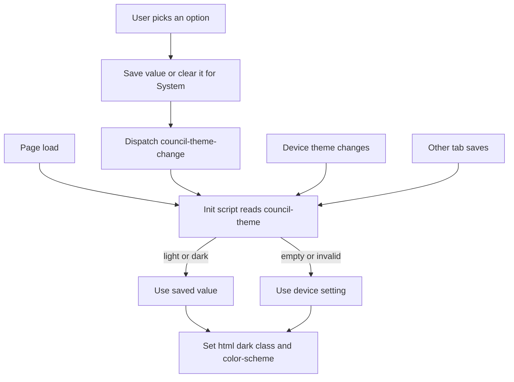

# Council Frontend — Theme Preference (System / Light / Dark)

| | |
|---|---|
| **Version** | 1.1 |
| **Status** | Approved |
| **Date Created** | 2026-10-16 |
| **Last Updated** | 2026-10-16 |

| Version | Date | Change |
|---|---|---|
| 1.1 | 2026-10-16 | §2 Definition of Done: storage-unavailable bullet corrected — the choice does not last for the page session, the page reverts to the device theme. §7 adds the matching test. |
| 1.0 | 2026-10-16 | Initial draft. Approved the same day: the user asked to implement now. |

> **Summary.** The theme toggle never persists and has no "follow my device" option. Root cause: the inline script in `lib/theme.ts` has a `try` with no `catch`, so the browser throws a SyntaxError and the script never runs; a saved choice is never re-applied on reload. Fix the script, add a third "System" mode that tracks the OS setting live, and make System the default.

---

## 1. Problem Statement

| Finding | Implication |
|---|---|
| `themeInitScript()` is `(function(){try{...})();` — `try` without `catch`/`finally` | Script is a SyntaxError on every page; saved theme is never restored, first paint ignores the OS setting |
| `ThemeToggle` only flips light ↔ dark and writes `council-theme` | The choice is stored but never read back; there is no way to return to "follow device" |
| Nothing listens to `prefers-color-scheme` changes | Even a correct first paint would go stale when the OS switches (e.g. sunset auto-dark) |

## 2. Definition of Done

- A first-time visitor sees the theme of their device, with no light/dark flash on load.
- The nav control offers **System**, **Light**, **Dark**; the active one is visibly selected.
- Light/Dark persist across reloads and tabs. System is stored as the absence of a saved value, so existing saved `light`/`dark` values stay valid.
- While on System, an OS theme change updates the page without a reload.
- Storage being unavailable (private mode) never throws; the choice simply is not saved and the page follows the device.
- `bun run typecheck`, `bun run lint`, `bun test` clean.

Out of scope: a light variant of the 3D scenes (they stay dark, per `council-frontend-3d-redesign.md` v1.1).

## 3. Feature Description

One source of truth for "what is the effective theme": the inline script in `<head>`. It reads `council-theme`, falls back to `prefers-color-scheme`, sets `html.dark` and `color-scheme`, and re-runs on three triggers: OS media change, `storage` (other tabs), and a same-tab `council-theme-change` event. The toggle only writes storage and dispatches that event, so apply logic is not duplicated in React.

`use-theme-preference.ts` exposes the stored preference via `useSyncExternalStore` (server snapshot `"system"`). `use-is-dark.ts` loses its only consumer and is deleted.

## 4. Flowchart



## 5. UI/UX Changes (Lo-Fi)

Before: a single 40×40 icon button (sun or moon) that flips the theme.

After: a three-option segmented control in the same nav slot.

```
┌──────────────┐
│ [🖥] ☀  ☾  │   active option has the --pill-on fill, others muted
└──────────────┘
```

Each option is a button with `aria-label` ("System theme", "Light theme", "Dark theme") and `aria-pressed`; the group has `role="group"` and `aria-label="Theme"`.

## 6. Impacted Files

| Action | File |
|---|---|
| MODIFY | `frontend/lib/theme.ts` — fixed script, types, event name |
| MODIFY | `frontend/components/layout/theme-toggle.tsx` — segmented control |
| NEW | `frontend/hooks/use-theme-preference.ts` |
| DELETE | `frontend/hooks/use-is-dark.ts` |
| NEW | `frontend/__tests__/theme.test.ts` — parses the init script and runs it against a fake `document`/`localStorage`/`matchMedia` |

## 7. Verification Plan

**Automated** (`bun test`): init script is valid JS; no saved value + OS dark → `dark`; no saved value + OS light → light; saved `light` beats OS dark; saved `dark` beats OS light; garbage value falls back to OS; throwing `localStorage` falls back to OS; OS change re-applies only when no explicit value is saved.

**Manual:** pick each option, reload, confirm it sticks; on System flip the OS appearance and watch the page follow; open a second tab, change the theme, confirm the first tab follows; hard reload in dark and confirm no white flash.

---

## Prompt History

### v1.0 — 2026-10-16
> Dan ini the-council tolong untuk tema nya ngikutin system device, dan bisa disimpan. Sekarang tema gelap terang gak bisa disimpan.
> Dan gak ada opsi system device juga
